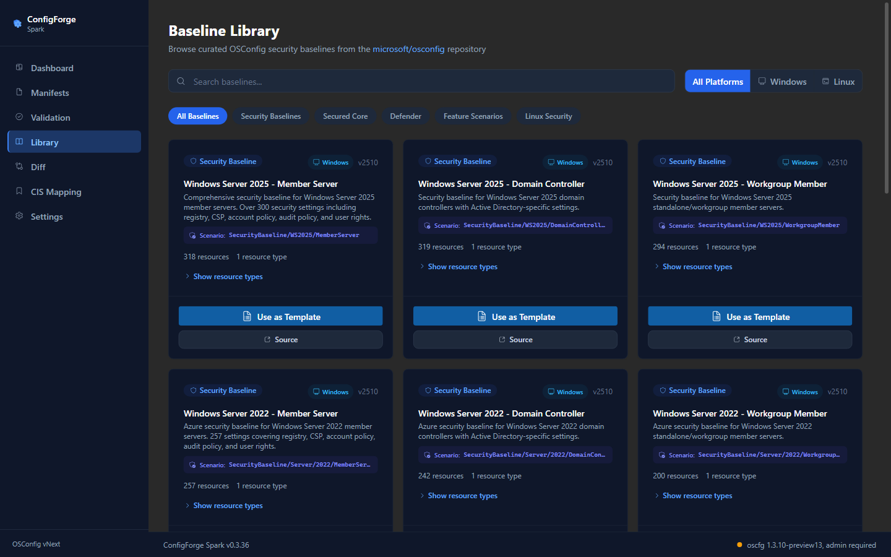
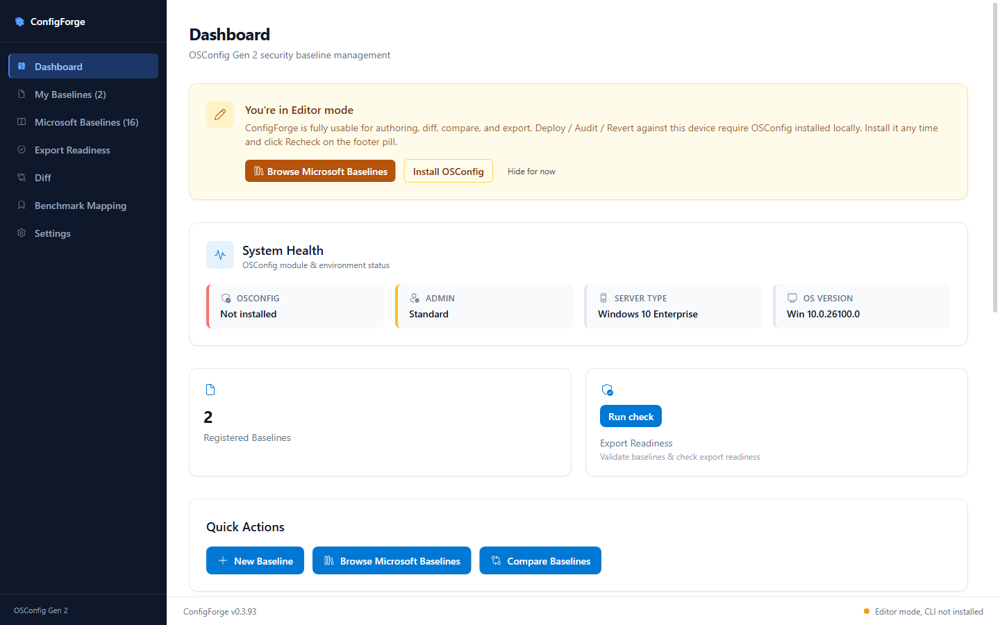
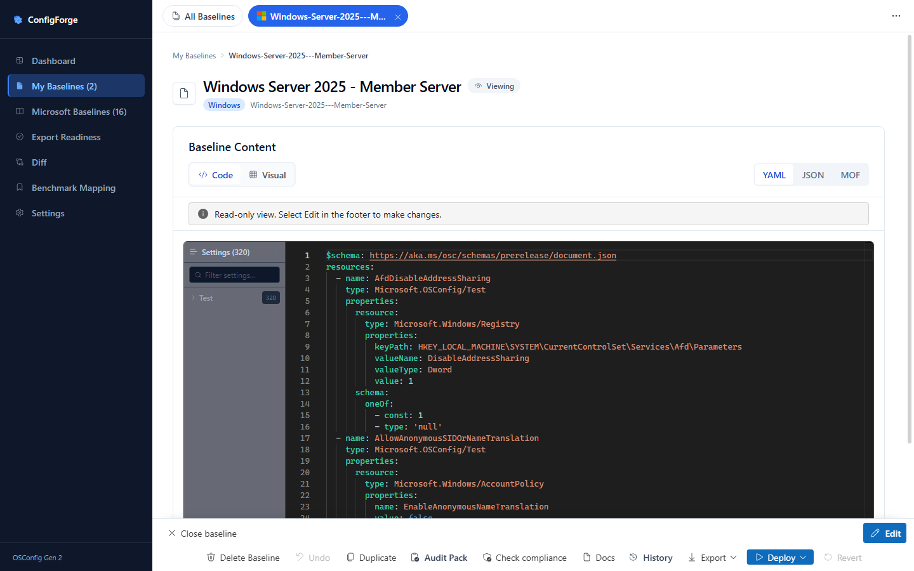
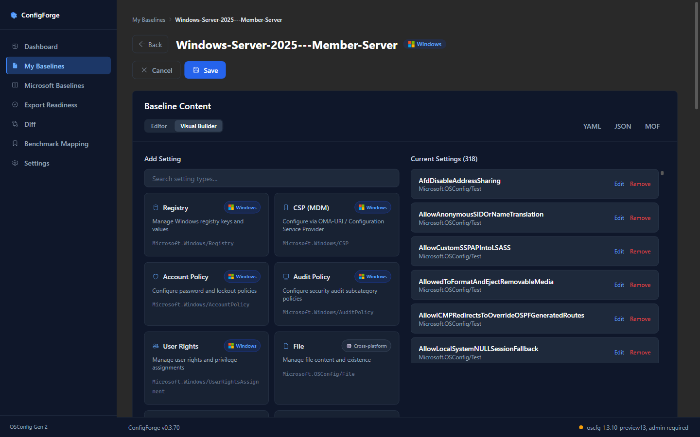
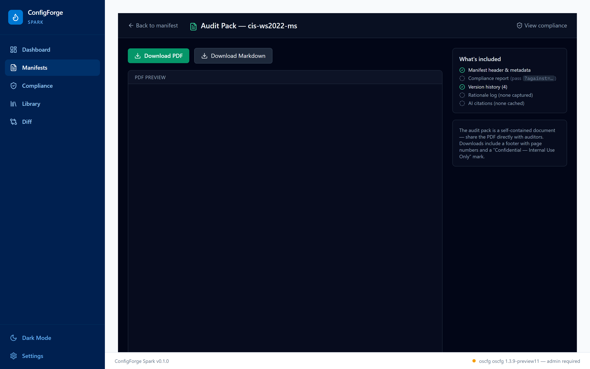
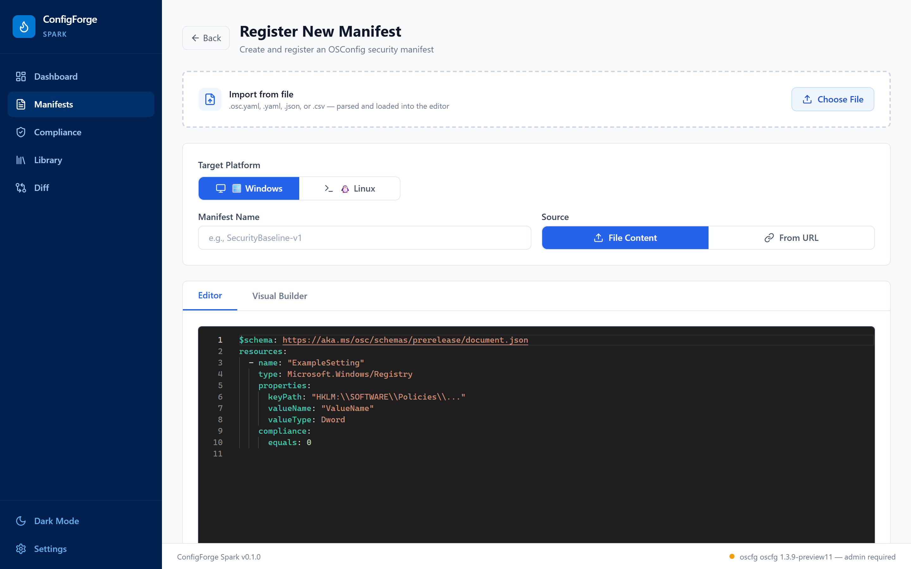
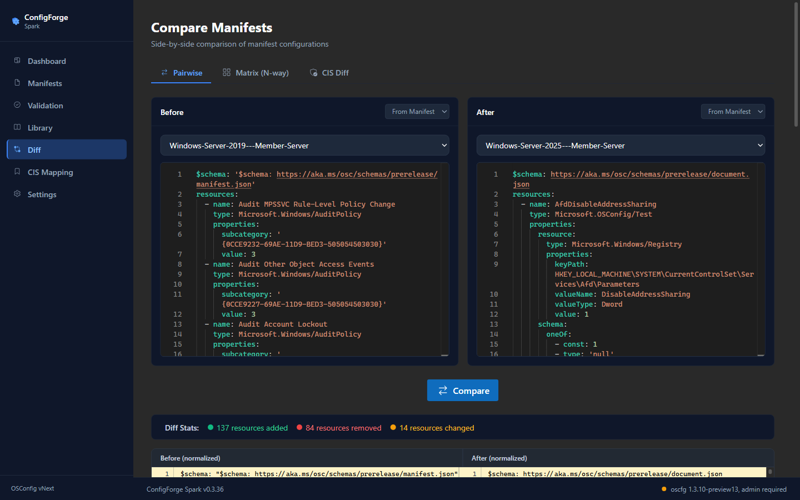
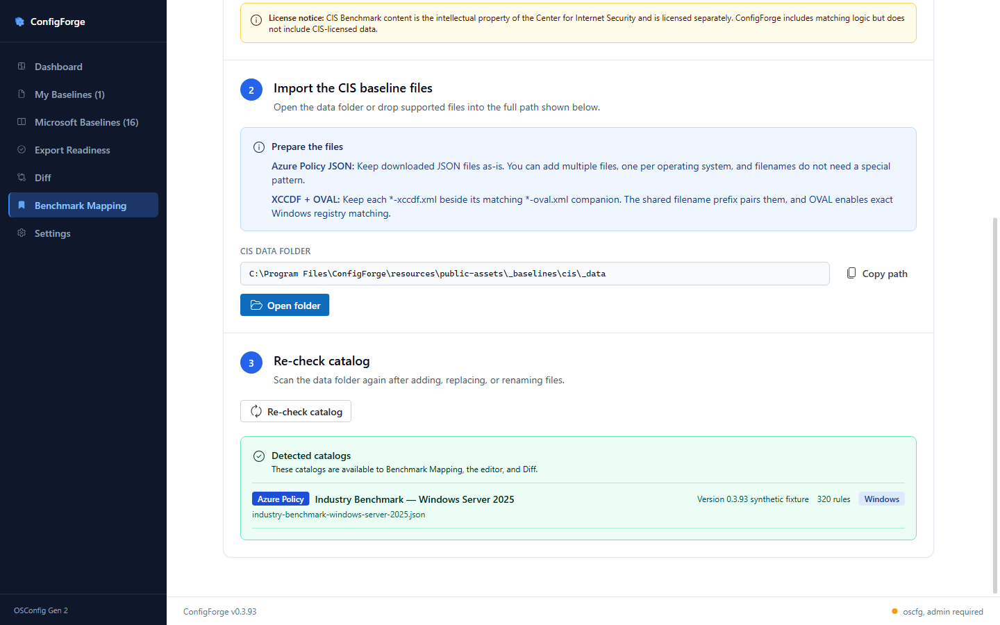
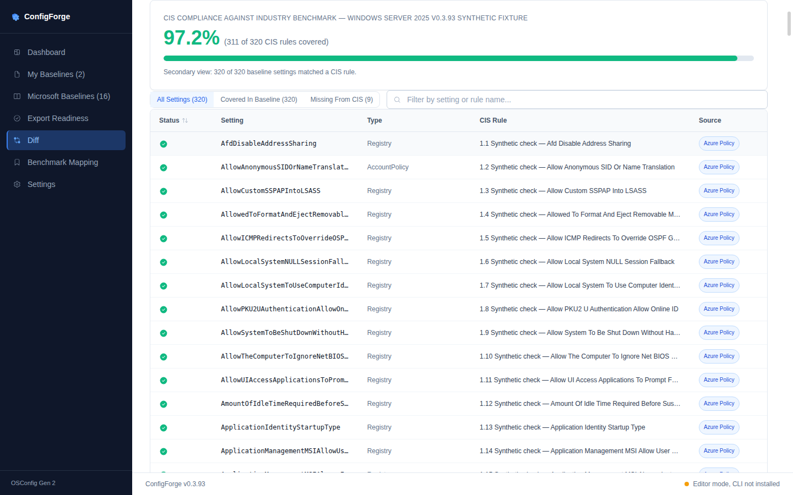

# ConfigForge

**Create, compare, and share OSConfig security baselines—before changing a device.**
Start with a Microsoft baseline or your own settings, review them visually, and
export a baseline or review report. No CLI, administrator access, or Azure
subscription is needed for authoring.

> **Experimental, community-maintained, and provided as-is.** ConfigForge is
> not an officially supported Microsoft product and is **not intended for
> production use**. Use it for learning and evaluation at your own risk.
> [Support boundaries](./SUPPORT.md)

**[Download releases](https://github.com/Azure/ConfigForge/releases)** ·
**[Documentation](https://azure.github.io/ConfigForge/)** ·
**[First baseline walkthrough](./docs/src/quick-start/first-manifest.md)**

## Download the right edition

This branch is the **macOS Author edition** (`mac-author-build`). It supports
baseline authoring and review, but does not expose device Deploy, Audit,
Enforce, Revert, elevation, or CLI-health controls.

| Your computer | Download | What you can do |
| --- | --- | --- |
| Windows or Linux (x64) | **Full** — [v0.3.103](https://github.com/Azure/ConfigForge/releases/tag/v0.3.103) | Author, validate, compare, and export. Optional local Deploy, Audit, and Revert require the separately installed `oscfg` CLI. |
| macOS on Apple Silicon (M1 or later) | **Author** — [mac-v0.3.101-author.1](https://github.com/Azure/ConfigForge/releases/tag/mac-v0.3.101-author.1) | The same authoring and review workflows, including Audit Pack export; no device operations. ARM64 only—not Intel or universal. |

Both releases are **prereleases**. Full-edition package versions are `0.3.103`;
the macOS Author package version is `0.3.101-author.1`.

**Downloads are unsigned; macOS builds are also not notarized.** Download only
from this repository's release page, compare the asset's SHA-256 with the
published checksum, and follow your organization's software policy.
Checksums check file integrity, not publisher identity or safety. Do not
disable SmartScreen or Gatekeeper globally. See [installation and download
warnings](./INSTALL.md#install-the-desktop-app) before opening an installer.
Building from reviewed source is another option, not a safety guarantee.

## Create your first baseline

A **baseline** is a set of desired settings. A **manifest** is the YAML or JSON
document that describes those settings. **Register** means save a baseline to
your ConfigForge workspace—not apply it to a device.

1. Install and open the edition for your computer. If the Welcome dialog
   appears, choose **Author baselines anywhere**.
2. Open **Microsoft Baselines**, choose a baseline to explore, and select
   **Use as Template**.
3. Give your copy a unique name, review its settings in **Visual** or **Code**,
   and select **Register Baseline**.
4. Open it from **My Baselines** and choose **Export → YAML** to save a portable
   copy.

**Success:** your baseline appears in My Baselines and you have an exported
`.osc.yaml` file. You have not deployed or audited anything. A Full-edition
**Editor mode, CLI not installed** indicator is expected and does not block
this workflow.

For screenshots, alternative starting points, and a small YAML example, follow
[Your first baseline](./docs/src/quick-start/first-manifest.md).

## Choose what to do next

| Your goal | Guide | Extra requirements |
| --- | --- | --- |
| Edit settings or import YAML, JSON, CSV, or XLSX | [Baseline editor](./docs/src/user-guide/manifest-editor.md) | None for authoring |
| Compare two baselines or a matrix of up to ten | [Diff](./docs/src/user-guide/matrix-diff.md) | None |
| Map settings to a benchmark | [Benchmark Mapping](./docs/src/user-guide/cis-compliance.md) | Your own legally licensed benchmark data; CIS data is not bundled |
| Record why settings changed | [Rationale](./docs/src/user-guide/rationale.md) and [history](./docs/src/user-guide/history-snapshots.md) | None |
| Export a PDF or Markdown review report | [Audit Pack](./docs/src/user-guide/audit-pack.md) | Uses available saved data; does not run a device Audit |
| Evaluate a local lab device | [Authoring vs deploying](./docs/src/quick-start/authoring-vs-deploying.md) | Full edition, matching Windows/Linux host, CLI, and appropriate privileges |
| Evaluate a baseline through Azure Policy | [Machine Configuration](./docs/src/user-guide/machine-configuration.md) | Separate packaging environment and Azure permissions |

**Benchmark coverage is not proof of device compliance.** A mapped setting
does not establish that its value is correct or that a device uses it. An
**Audit Pack** is an exported report; **Audit** checks a device through `oscfg`.
Missing or old device results must not be presented as a current audit.

## What it looks like

Screenshots illustrate the workflows; exact layout varies by release and
edition. Device controls shown in Full-edition screenshots are absent on macOS.

Explore the editor, comparison, and report screenshots

The screenshots below are shared documentation captures that use synthetic
Industry Benchmark content. They commit no CIS data and do not add
device-operation capabilities to the macOS Author edition.

### Microsoft Baselines: start from a curated catalog

Browse Windows Server role baselines, Defender, LAPS, Secured Core, and the
Linux Security Baseline. **Use as Template** creates your own editable copy.

### Dashboard: system health + quick actions

Start a baseline, browse Microsoft Baselines, or compare existing work.
The Full edition also surfaces CLI and device health.

### My Baselines: localized catalog and persistent workspaces

Search and filter baselines, open persistent tabs, and compare selected items.
Unsaved-edit prompts help protect work when closing a tab or navigating away.

### Baseline editor: author and export an Audit Pack

Review Code or Visual views, edit settings, and export your work.

### Visual spreadsheet: edit settings in place

Edit cells, add supported setting types, or remove selected rows. Nested
Test/Group structure, typed values, and exact QWord integers are preserved.

### Audit pack: the auditor deliverable

Export PDF or Markdown from saved baseline, history, and available review data.
No device audit is performed when generating the report.

### Create a new baseline: choose from five starting points

Start a custom Windows/Linux baseline, choose a template, import a baseline
file, import a spreadsheet, or load a public URL.

### Compare baselines: Pairwise, CIS, Matrix

Two selected baselines open Pairwise; three through ten open Matrix.
The CIS view requires user-supplied benchmark data.

### Benchmark Mapping: bring-your-own benchmark data

Use the data folder shown in **Benchmark Mapping**, then re-check the catalog.
See the [data setup guide](./docs/src/user-guide/cis-compliance.md).

### CIS Diff: bulk compliance scoring

The percentage measures unique benchmark rules covered by matching settings,
not device compliance or certification.

## Optional: install the OSConfig CLI for Deploy / Audit

This section is for the **Full edition on Windows/Linux**. Installing a CLI
does not enable device operations in macOS Author.

The native [`oscfg`](https://github.com/microsoft/osconfig/tree/main/docs/cli)
CLI is **not bundled**. It is separate from the PowerShell modules used for
Machine Configuration packaging. The targeted CLI is `oscfg 1.3.9-preview11`;
see [INSTALL.md](./INSTALL.md#optional-local-device-operations) for setup.

Start with Audit on a disposable, matching-platform device. Enforce changes
settings; Revert is not a substitute for a machine backup. On Windows, the
preview CLI requires elevation even for Audit. Authoring does not.

## Export to Azure Machine Configuration

This is an **advanced, optional workflow**, not a prerequisite for using the
app:

`ConfigForge baseline → MOF → resolved MOF → Machine Configuration ZIP → Azure Storage → generated policy JSON → policy definition → assignment`

The macOS Author edition can export the MOF. Move it to a Windows or Ubuntu
packaging/test environment; local Machine Configuration package testing is
not supported on macOS.

On the **packaging machine**, `New-GuestConfigurationPackage` needs the
**Microsoft.OSConfig PowerShell module version 1.4.10 or later** to bundle the
OSConfig DSC resource. Install it with
`Install-Module -Name Microsoft.OSConfig -MinimumVersion 1.4.10`.
This is a **module version**, not a PowerShell runtime version. PowerShell 7
and the separate **GuestConfiguration** packaging toolkit are also required.

The [complete Machine Configuration guide](./docs/src/user-guide/machine-configuration.md)
checks for a qualifying installed module, binds the exported
`ModuleVersion = "0.0.0"` placeholder to that exact version, and creates an
Audit-first package. Keep each ZIP and its URI immutable after policy
generation: the policy contains the package hash. Test the baseline and
module combination; the minimum version is not a claim that every OSConfig
issue is resolved. [Module release](https://www.powershellgallery.com/packages/Microsoft.OSConfig/1.4.10)

## Quick start: run from source

Source builds are optional. Follow [Build from source](./docs/src/quick-start/install-run.md#build-from-source-optional)
for the separate Full and macOS Author commands and the supported Node
toolchain. You do not need Node.js to run a downloaded desktop build.

## Building installers

See [desktop packaging](./apps/desktop/PACKAGING.md) for platform-specific
commands, build-host requirements, and smoke checks. Full Linux installer
builds require Linux; macOS Author builds require Apple Silicon.

## Repo layout

The desktop app uses Electron, React, Fluent UI, and Vite. Its shared core
lives in `packages/core`; the documentation site lives in `docs`.
See the [system overview](./docs/src/architecture/system-overview.md) and
[module map](./docs/src/architecture/module-map.md) for developer details.

## Documentation

- [Documentation site](https://azure.github.io/ConfigForge/) and [source navigation](./docs/src/SUMMARY.md).
- [Troubleshooting](./docs/src/operations/troubleshooting.md), [support](./SUPPORT.md), and [privacy](./PRIVACY.md).
- Developer references: [design contract](./apps/desktop/DESIGN.md),
  [platform UX](./apps/desktop/src/design/PLATFORM.md), [packaging](./apps/desktop/PACKAGING.md),
  and [CI/release workflow](./apps/desktop/CI.md).

## Contributing

See [CONTRIBUTING.md](./CONTRIBUTING.md) and [AGENTS.md](./AGENTS.md)
for ownership, active-branch, review, release, and cherry-pick guidance.
Report reproducible bugs through [GitHub Issues](https://github.com/Azure/ConfigForge/issues);
include the edition, version, OS, and a minimal non-sensitive example.

## Release history (high-level)

See [CHANGELOG.md](./CHANGELOG.md) for detailed historical validation and
[the documentation changelog](./docs/src/changelog.md) for a shorter summary.
Past module-version validation records are not current packaging prerequisites.

Historical release highlights, including the macOS Author line

| Version | Highlights |
|---|---|
| **0.3.101-author.1** (current macOS prerelease) | Ports the author-safe WS2022 baseline repairs, lossless QWord and Registry handling, Machine Configuration packaging compatibility, Node 24 build support, and dependency-security fixes. |
| **0.3.101** (prior Windows/Linux prerelease) | Clears the remaining dependency alerts after the verified OSConfig enforcement and Machine Configuration fixes. |
| **0.3.98-author.1** (prior macOS prerelease) | Adds complete Machine Configuration documentation and removes stale/internal public-doc guidance. |
| **0.3.98** (prior Windows/Linux source) | Adds the same public Machine Configuration guide and documentation cleanup to the Full edition. |
| **0.3.97-author.1** (prior macOS draft) | Preserves authoritative CLI reasons and adds detailed templates to every WS2025 control. |
| **0.3.97** (prior Windows/Linux draft) | Preserves authoritative CLI reasons for expression-backed Test resources and adds detailed WS2025 reason templates. |
| **0.3.96-author.1** (prior macOS draft) | Ports the full 320/321/296 WS2025 control-preservation work and global Machine Configuration MOF export fixes from main PR #104 through PR #105. |
| **0.3.96** (prior Windows/Linux draft) | Preserves every WS2025 control while fixing Registry/CSP contracts and CEL compliance, and hardens Machine Configuration MOF export in PR #104. |
| **0.3.95-author.1** (prior macOS draft, unpublished) | Fixes unreliable My Baselines status tooltips by replacing native HTML hover titles with FluentUI tooltips (PR #101), and ports documentation-accuracy corrections from main PR #97 (PR #99). |
| **0.3.95** (prior Windows/Linux draft, unpublished) | Replaces unreliable My Baselines status tooltips with FluentUI tooltips (PR #100) and corrects documentation drift (PR #97). |
| **0.3.94-author.1** (prior macOS draft, unpublished) | Carries the public-source packaging, policy, privacy, security, and nine synthetic screenshot updates into the author-only Apple Silicon edition without adding device operations. |
| **0.3.94** (prior Windows/Linux tagged source) | Excludes CIS benchmark source data from public installers, publishes the public licensing/privacy/support/security policy surface, patches dev-only `brace-expansion` 5.x, and refreshes nine README screenshots with synthetic benchmark content in PR #89. |
| **0.3.93-author.2** (prior macOS draft, unpublished) | Ports the standalone Windows Server 2025 audit repairs, corrected CIS aliases, Source-link cleanup, and policy-identity fixes through PR #83; PR #84 prepares the immutable tag. Workflow run #30186678580 verified all five assets. |
| **0.3.93-author.1** (prior macOS draft, unpublished) | Restored complete macOS authoring parity and nested Enter/Tab editing through PRs #75, #76, and #77; PR #79 finalized documentation and immutable-tag release tooling, and PR #80 merged the tagged release branch. Workflow run #30176765724 verified all five assets. |
| **0.3.93** (prior Full edition) | Adds nested Enter/Tab editing and repairs standalone Windows Server 2025 audits, CIS mapping, and Matrix Diff policy identity handling |
| **0.3.92** | Patches the desktop updater, AppImage packager, PostCSS processor, and archive toolchain against newly disclosed vulnerabilities |
| **0.3.91** | Shows stacked Test schema rules in Visual mode and enforces supported constraints on newly edited values |
| **0.3.90** | Prevents Baseline Detail footer collisions and keeps long multi-value Visual rows inside their table columns |
| **0.3.89** | Completes Baseline Detail spreadsheet authoring, typed multi-value editing, accessible Add settings, deterministic history, and all current Dependabot fixes |
| **0.3.88** | Completes the July Loop revisions with pill tabs, sortable and left-aligned baseline data, reliable status tooltips, and safe one-click Undo |
| **0.3.87** | Removes the local `ImpersonateClient` manifest override while retaining minimum-version handling for oscfg 1.3.9 or newer |
| **0.3.86** | Current OSConfig-compatible `ImpersonateClient` YAML and minimum-version handling for oscfg 1.3.9 or newer |
| **0.3.85** | My Baselines rows stay behind the opaque sticky column header while scrolling |
| **0.3.84** | Export options are limited to YAML, JSON, MOF, and CSV; all remaining high-severity development dependency advisories are cleared |
| **0.3.83** | Development dependency security refresh: `tar` 7.5.20 and `axios` 1.18.1; no runtime feature changes |
| **0.3.82** | Baseline document identity, view-only Visual feedback, top/bottom Add setting actions, and Matrix baseline search |
| **0.3.81** | Footer actions retain labels and reflow into balanced compact rows across Electron resolutions |
| **0.3.80** | First-class OSConfig CSV imports, a responsive no-scroll Baseline Detail footer, and correct Save → Skip navigation after compliance deep links |
| **0.3.79** | Search compliance reports, filter by Compliant / Non-compliant / Could not read, and sort by status |
| **0.3.78** | Correct baseline platform icons and Monaco warning styling; persist compliance reports and move them into a large centered dialog |
| **0.3.77** | Completed Loop design pass: five-source baseline wizard with in-place Microsoft template selection, real XLSX import, visible Date Modified values, per-baseline Code/Visual memory, and Save/Discard/Cancel close protection |
| **0.3.76** | Cognitive Walkthrough polish: Pairwise Diff for two selections, shared Code/Visual Undo, a device-compliance drawer, final-cell Enter row creation, faster OSConfig recheck, corrected platform/status presentation, and streamlined onboarding/Benchmark Mapping |
| **0.3.62 – 0.3.68** | Rebrand **ConfigForge Spark → ConfigForge**; vocabulary refresh (**Manifests → My Baselines**, **Library → Microsoft Baselines**, **Validation → Export Readiness**, **CIS Mapping → Benchmark Mapping**, *resource* → *setting*, **OSConfig vNext → Gen 2**); unsigned OSS release pipeline with `SHA256SUMS` + SBOM verification; MOF export targets the `Microsoft.OSConfig` module; Monaco overflow-widget dropdown root-cause fix; "Could not read" compliance bucket on baseline cards |
| **0.3.54 – 0.3.61** | Localization rollout (FR / DE / ES) — five extraction waves, machine-translation + review tooling, `Intl` date/number/relative-time formatters, and length/overflow visual QA |
| **0.3.45 – 0.3.53** | Benchmark (CIS) Mapping subtitle + Diff › CIS tab; real History change summaries + auto-scroll Compare; CIS fuzzy-matching tightening; Group resources expand inline in Visual Builder; Diff "Select baseline" dropdown stability (Monaco overflow fix) |
| **0.3.27 – 0.3.36** | CIS matcher quality pass (CSP UserRights, alias table, XCCDF fuzzy fallback, 36/36 mappable UserRights match WS2025 CIS); 100x cis.status() perf fix; 3-second warmup deferral eliminates manifest-open regression; ResourceChangesPanel and Resource-level diff stats; AI summary numbers consistent across panels |
| **0.3.14 – 0.3.26** | CIS Mapping page (Azure Policy JSON + XCCDF/OVAL XML auto-detect), CIS cross-reference drawer in the manifest editor, CIS Diff tab on the Diff page, settings store with history retention, deploy recovery banner, breadcrumb navigation |
| **0.2.1** | Phase A-E renderer-page split; 15/15 security audit findings closed; typed main-process logger with secret redaction; Prettier config; CSV-import schema fix |
| **0.2.0** | Bring-your-own-CLI: removed bundled `oscfg` binary, added Welcome dialog + CliRequiredModal, well-known-paths binary resolver, MSIX fallback. Legal scaffolding (LICENSE / NOTICE / SECURITY / THIRDPARTYNOTICES) for OSS readiness |
| **0.1.x** | Initial Electron migration in 10 phases (Next.js to Electron + React Router + FluentUI v9 + Vite). See git log on `main` for per-phase commits |

## Code of Conduct

This project has adopted the [Microsoft Open Source Code of Conduct](https://opensource.microsoft.com/codeofconduct/). For more information see the [Code of Conduct FAQ](https://opensource.microsoft.com/codeofconduct/faq/) or contact [opencode@microsoft.com](mailto:opencode@microsoft.com) with any additional questions or comments.

## Security

To report a security vulnerability, follow [SECURITY.md](./SECURITY.md).
**Do not** file security issues as public GitHub issues. ConfigForge does not
collect telemetry; see [PRIVACY.md](./PRIVACY.md).

## License

Licensed under the [MIT License](./LICENSE). Third-party components are described in [NOTICE](./NOTICE) and [THIRDPARTYNOTICES.md](./THIRDPARTYNOTICES.md).

## Trademarks

This project may contain trademarks or logos for projects, products, or services. Authorized use of Microsoft trademarks or logos is subject to and must follow [Microsoft's Trademark & Brand Guidelines](https://www.microsoft.com/en-us/legal/intellectualproperty/trademarks/usage/general). Use of Microsoft trademarks or logos in modified versions of this project must not cause confusion or imply Microsoft sponsorship. Any use of third-party trademarks or logos are subject to those third-party's policies.
